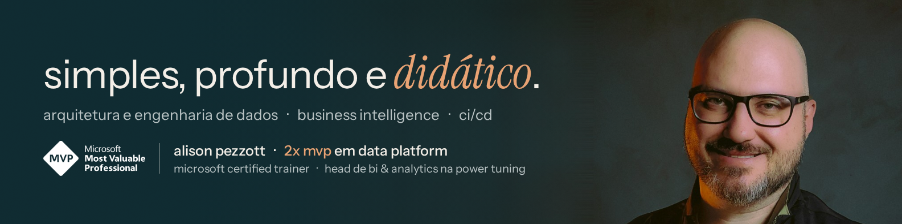

## About

- **[Microsoft MVP, Data Platform](https://mvp.microsoft.com/pt-BR/MVP/profile/807db423-418d-4c8d-bb59-08732cdbbf34)** and **[Microsoft Certified Trainer (MCT)](https://learn.microsoft.com/en-us/users/alisonpezzott-4199/transcript)**
- Head of BI & Analytics at **[Power Tuning](https://www.linkedin.com/company/sou-powertuning/)**
- Creator of **[pyfabricops](https://github.com/alisonpezzott/pyfabricops)**, a Python wrapper for the Fabric & Power BI REST APIs
- Sharing hands-on content on **[YouTube](https://www.youtube.com/@alisonpezzott?sub_confirmation=1)**: data architecture and engineering, BI, development and CI/CD, with real examples and demos
- Speaker at technical community events

## Featured projects

| Project | Description |
| --- | --- |
| [pyfabricops](https://github.com/alisonpezzott/pyfabricops) | Python wrapper for the Microsoft Fabric & Power BI REST APIs. |
| [fabricopsflow](https://github.com/alisonpezzott/fabricopsflow) | CI/CD framework for end-to-end automation of Fabric projects, with Azure DevOps Pipelines and Service Principal authentication, powered by pyfabricops. |
| [FabricOpsFlow-PBI-Pro](https://github.com/alisonpezzott/FabricOpsFlow-PBI-Pro) | FabricOpsFlow variant for Power BI Pro environments. |
| [pbi-ci-cd-isv-multi-tenant](https://github.com/alisonpezzott/pbi-ci-cd-isv-multi-tenant) | Power BI CI/CD for ISV multi-tenant scenarios. |
| [pbi-docs](https://github.com/alisonpezzott/pbi-docs) | Power BI documentation. |
| [calendar](https://github.com/alisonpezzott/calendar) | Calendar (date) table for analytical models. |
| [calendario-sql](https://github.com/alisonpezzott/calendario-sql) | Calendar (date) table in SQL. |
| [useful-snippets](https://github.com/alisonpezzott/useful-snippets) | My general useful daily snippets |

All repositories: [github.com/alisonpezzott?tab=repositories](https://github.com/alisonpezzott?tab=repositories&sort=stargazers)

## Community

Talks, events and contributions to the technical community, by Microsoft MVP award year:

- [April 2026 – March 2027](https://github.com/alisonpezzott/community-contributions-20260401-20270331)
- [April 2025 – March 2026](https://github.com/alisonpezzott/community-contributions-20250401-20260331)

## Connect

[YouTube](https://www.youtube.com/@alisonpezzott?sub_confirmation=1) · [LinkedIn](https://linkedin.com/in/alisonpezzott) · [Instagram](https://instagram.com/alisonpezzott)
